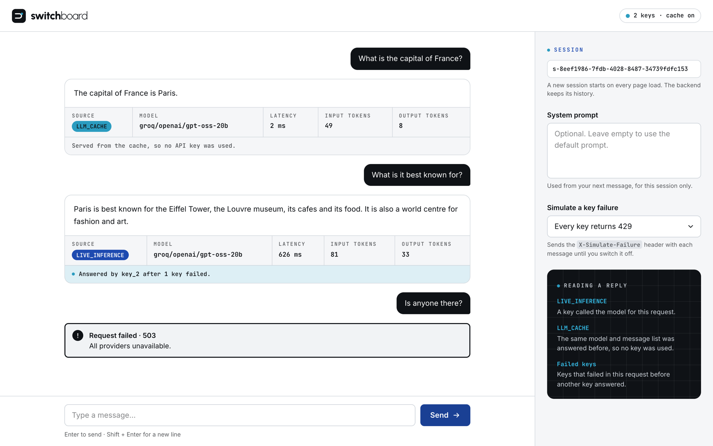

# Switchboard: LLM chat with key failover and response caching

A small full-stack chatbot. The React frontend talks to a FastAPI backend, which calls the model
through LiteLLM. The backend keeps each conversation in SQLite, switches to the next API key when a
key fails, and answers repeated prompts from a cache. Every reply shows where it came from, which
model answered, how long it took and how many tokens that one request used.



```
frontend/   React + Vite single page app (served by nginx in Docker)
backend/    FastAPI app, LiteLLM gateway, SQLite storage, tests
scripts/    verify.py: checks a running backend against the API contract
docker-compose.yml, Makefile, .env.example
```

## 1. Live URLs

| What | URL |
| --- | --- |
| Frontend | `TODO: paste the deployed frontend URL` |
| Backend | `TODO: paste the deployed backend URL` (try `/health`) |
| Demo video | `TODO: paste the video link` |

The deployed backend runs with `ENABLE_FAILURE_SIMULATION=true`, so failover can be tested with the
`X-Simulate-Failure` header.

History is durable wherever `/data` is a persistent volume, which it is with `make up`. On a host
with an ephemeral disk, such as a free plan without a volume, the history resets when the container
restarts.

## 2. Run locally

Both ways need a `.env` file with at least two API keys for the model's provider. The default model
runs on Groq's free plan, and the keys are created at https://console.groq.com/keys.

```bash
cp .env.example .env      # then put your real keys in LLM_API_KEYS
```

### With Docker

```bash
make up      # builds both images and waits until the backend is healthy
make down    # stops the stack (the SQLite volume is kept)
```

- Frontend: http://localhost:3000
- Backend: http://localhost:8000 (for example http://localhost:8000/health)

The SQLite file lives in the named volume `chat-data`, mounted at `/data`, so history survives
`make down` and `make up`.

### Without Docker

Backend (Python 3.12):

```bash
cd backend
python3 -m venv .venv && source .venv/bin/activate
pip install -r requirements-dev.txt
DATABASE_URL=sqlite:///./app.db uvicorn app.main:create_app --factory --env-file ../.env --port 8000
```

Frontend (Node 22 or newer), in a second terminal:

```bash
cd frontend
npm install
npm run dev      # http://localhost:3000
```

Tests (no API keys or network needed):

```bash
make test        # or: cd backend && python3 -m pytest
```

### Environment variables

| Variable | Meaning |
| --- | --- |
| `LLM_API_KEYS` | Comma-separated key pool, at least 2 keys. Key ids are `key_1`, `key_2`, ... in this order. |
| `LLM_MODEL` | LiteLLM model name used with every key. Default `groq/openai/gpt-oss-20b`. |
| `LLM_API_BASE` | Optional base URL for a self-hosted or OpenAI-compatible provider. |
| `DATABASE_URL` | SQLite location, for example `sqlite:////data/app.db`. |
| `ALLOWED_ORIGINS` | Comma-separated CORS origins (the frontend URL). |
| `ENABLE_FAILURE_SIMULATION` | `true` enables the `X-Simulate-Failure` test hook. |
| `VITE_API_BASE_URL` | Frontend only, read at build time: the backend URL the browser calls. |

## 3. Design decisions

### Key fallback

- **LiteLLM does the failover.** Each API key is registered in a LiteLLM `Router` as its own
  deployment (`key_1`, `key_2`, ...), and the router gets one fallback list:
  `key_1 -> key_2 -> key_3 ...`. Every request starts at `key_1`. See `backend/app/llm.py`.
- **Any failed key moves on to the next one.** That covers HTTP 429, quota errors, 5xx, timeouts and
  a rejected key. Retries on the same key are off (`num_retries=0`), because a second key is a
  better use of the time than waiting on a rate-limited one.
- **No cooldowns** (`disable_cooldowns=True`). Each request tries the keys in the same order, so the
  result is predictable and one request's failure cannot change the next request. The cost is one
  wasted call per request while `key_1` is down. With many keys or heavy traffic I would turn
  cooldowns on.
- **Every key failed:** the API answers `503 {"detail": "all providers unavailable"}` and stores
  nothing.
- **What two keys cover.** Groq counts rate limits per organization, not per key, so keys from one
  account share one quota. They cover a revoked or broken key. When the quota itself runs out,
  every key fails and the answer is the 503 above.
- **`key_id` and `fallback_attempts`** are read from LiteLLM's response: the id of the deployment
  that answered and the number of fallbacks it attempted.
- **`X-Simulate-Failure`** is a LiteLLM pre-call hook. Just before LiteLLM calls a key that the
  header lists, the hook swaps the call for the error LiteLLM raises when a provider really returns
  that status (429, 500, 502 or 503). The failure then goes through the same fallback path as a real
  one. It applies to that request only, and only when `ENABLE_FAILURE_SIMULATION=true`.

### Caching

- **LiteLLM's built-in in-memory cache** (`Cache(type="local")` with `cache_responses=True`), with a
  one hour lifetime per entry.
- **Cache key: model + the full message list** (system prompt, history, new message). All keys share
  one cache group, so an answer produced by `key_2` is also a hit when `key_1` is asked later. The
  same first message in a new session is a hit. A different message, a longer history or a different
  system prompt is a new key.
- **A hit** returns the stored reply with `resolution_source: "LLM_CACHE"`, `key_id: null`,
  `fallback_attempts: 0` and the token usage stored with the cached response.
- **Simulated requests skip the cache** in both directions. `key_1=429` must show `key_2` answering
  and `*=429` must be a 503, even when that prompt is already cached.
- **Trade-off:** an in-memory cache needs no extra service and is fast, but it is empty after a
  restart and belongs to one process, so the backend runs as a single worker.

### SQLite session storage

- Python's built-in `sqlite3`, no ORM. The schema (`sessions`, `messages` and one index) is created
  on startup. See `backend/app/db.py`.
- `messages` is the table from the assignment. `sessions` holds one row per session with its system
  prompt, so the prompt never appears in the history.
- **A turn is saved only after the model answered**, as one transaction with both rows. A request
  that ends in 422 or 503 leaves no trace, and an unknown session id simply starts a new session.
- The client sends only the new message. The backend loads the history from SQLite and sends
  system prompt + history + new message to the model.
- The file location comes from `DATABASE_URL`. In Docker it is `/data/app.db` on a named volume.

### Smaller choices

- **Errors are always JSON with a `detail` field.** Validation errors are 422, an unknown session is
  404, and a catch-all handler turns anything unexpected into a plain 500 without a stack trace.
- **Exactly three endpoints.** FastAPI's generated `/docs` and `/openapi.json` are switched off.
- **Token counts are per request**, taken from the usage the provider returns for that call.
- **The provider is one setting.** `LLM_MODEL` takes any LiteLLM model name, and every key in the
  pool belongs to that model's provider. The default is `groq/openai/gpt-oss-20b`, which is on
  Groq's free plan.
- **`litellm` is pinned to 1.101.6.** Newer releases import optional proxy packages when a cached
  response is served, so a cache hit fails without them. `backend/requirements.txt` is a full lock.

## 4. Verification

### One command

`scripts/verify.py` runs 30 checks against a running backend (health, live call, cache hit, memory,
history, validation, failover) and prints PASS or FAIL for each. It makes 5 live model calls.

```bash
make verify                                  # http://localhost:8000
make verify URL=https://your-backend-url     # the deployed backend
```

### By hand

Set `API` to the backend URL, for example `API=http://localhost:8000`.

**Cache hit.** Send the same first message in two new sessions. The second answer has
`"resolution_source": "LLM_CACHE"`, the identical reply, `"key_id": null` and a much lower
`latency_ms`.

```bash
curl -s $API/chat -H 'Content-Type: application/json' \
  -d '{"session_id": "demo-1", "message": "What is the capital of France?"}'
curl -s $API/chat -H 'Content-Type: application/json' \
  -d '{"session_id": "demo-2", "message": "What is the capital of France?"}'
```

**Failover.** Make `key_1` fail for one request. The answer is a normal 200 with
`"key_id": "key_2"` and `"fallback_attempts": 1`.

```bash
curl -s $API/chat -H 'Content-Type: application/json' -H 'X-Simulate-Failure: key_1=429' \
  -d '{"session_id": "demo-3", "message": "Say hello."}'
```

**Every key down.** The answer is `503 {"detail": "all providers unavailable"}` and the history does
not change.

```bash
curl -s -i $API/chat -H 'Content-Type: application/json' -H 'X-Simulate-Failure: *=429' \
  -d '{"session_id": "demo-3", "message": "This is not stored."}'
```

**Per-message token usage and history.** Each stored assistant message carries the metadata of its
own request, so `input_tokens` grows turn by turn while each number stays per request.

```bash
curl -s $API/sessions/demo-3/messages
```

**In the UI.** Send a message, reload the page (a new session) and send the same message again: the
source chip changes from `LIVE_INFERENCE` to `LLM_CACHE`. Choose "key_1 returns 429" under
"Simulate a key failure" and send a message: the reply says it was answered by `key_2` after 1 key
failed. Choose "Every key returns 429": the chat shows the 503 as a readable error.

## 5. Setup Used

- Editor: VS Code
- AI tools: Claude Code (Anthropic's coding agent) for the implementation, the tests and this
  README. The LiteLLM behaviour the design depends on (fallback order, cache hits, the simulation
  hook) was checked with small experiments first, which is how the version pin above was found.

## 6. Bonus features

- **Failure simulation in the UI.** A dropdown sends `X-Simulate-Failure`, so failover and the 503
  path can be shown without curl.
- **Which key answered.** Each reply also shows the key id and how many keys failed first.
- **`scripts/verify.py`.** One command checks a local or deployed backend against the contract.
- **Tests against a fake provider.** The 45 backend tests run LiteLLM for real and point it at a
  small local HTTP server that speaks the Gemini API, so failover is tested with real 429 and 5xx
  responses and no API key is needed.
- **CI.** GitHub Actions runs the tests and starts the Docker stack with `make up` on every push.
- **Backend status in the header.** The UI polls `/health` until the backend answers, which also
  covers a free host that is waking up.
- **`LLM_API_BASE`.** Optional, for a self-hosted or OpenAI-compatible model endpoint.
